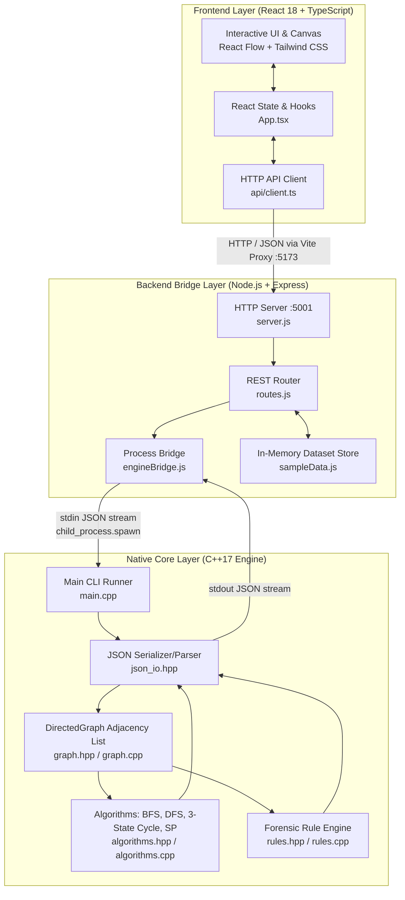
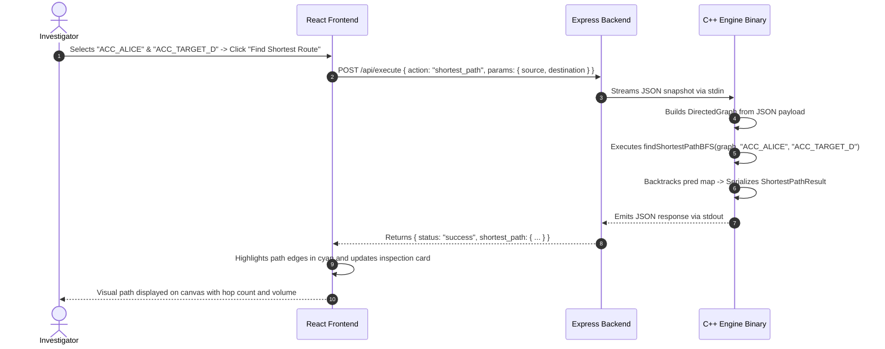

# System Architecture — FraudGraph

This document describes the design principles, inter-process communication (IPC) protocols, data flows, and component boundaries of **FraudGraph**.

---

## 1. Architectural Overview

FraudGraph adopts a decoupled three-tier architecture that isolates high-performance graph processing from presentation concerns:



---

## 2. Component Breakdown

### 2.1 Native C++17 Core Engine (`engine/`)
- **Language Standard:** ISO C++17 (`-std=c++17 -O2 -Wall -Wextra`).
- **Dependencies:** Vendor-vendored single-header `nlohmann/json.hpp` (v3.11.3) in `engine/include/nlohmann/`. Zero external runtime libraries.
- **Responsibilities:**
  - Constructing and maintaining the dual adjacency list (`adj_` for outgoing edges, `rev_adj_` for incoming edges).
  - Executing Breadth-First Search (BFS) and reconstructing shortest paths with predecessor pointers.
  - Executing Depth-First Search (DFS) with discovery and finish timestamps ($d[u], f[u]$).
  - Detecting directed cycles via Three-State node coloring (`WHITE`, `GRAY`, `BLACK`) and extracting cycle sequences.
  - Reconciling financial flows and calculating exact integer retention discrepancies in paise.
- **Binary Targets:**
  - `engine/bin/fraudgraph_engine`: Core production CLI and IPC receiver.
  - `engine/bin/test_engine`: Standalone automated unit test suite.

### 2.2 Backend API Bridge (`backend/`)
- **Runtime:** Node.js (v18+) with Express.js (`express: ^4.21.1`) and CORS.
- **Responsibilities:**
  - Hosting RESTful endpoints for dataset inspection, account creation, transaction recording, and algorithm execution.
  - Managing active working dataset state with catalog switching and baseline reset capabilities.
  - Safely spawning the native C++17 binary using `child_process.spawn`.
  - Streaming request payloads to the engine's `stdin` and collecting responses from `stdout`.
  - Enforcing execution timeouts (8,000ms safety kill) and structured error handling.

### 2.3 Frontend Dashboard (`frontend/`)
- **Technology Stack:** React 18, TypeScript 5, Vite 6, Tailwind CSS 3, React Flow 11, Lucide React icons.
- **Responsibilities:**
  - Providing an interactive node-and-edge visual graph canvas with animated edge flow and degree badges.
  - Implementing step-by-step playback controls for BFS and DFS traversal animations.
  - Offering a two-mode navigation experience: **Dataset Playground** (prebuilt benchmarks) and **Custom Investigation Lab** (freeform graph builder).
  - Displaying real-time forensic rule findings, discrepancy percentages, and neutral explainability panels.

---

## 3. Inter-Process Communication (IPC) Design

The communication between the Node.js backend and the C++ engine avoids shell command interpolation, eliminating command injection vulnerabilities.

### 3.1 Streaming Protocol
```
Node.js (engineBridge.js)                        C++17 Engine (main.cpp)
-------------------------                        ----------------------
   spawn(ENGINE_BIN)         ================>      Process starts
   write JSON payload        --- [stdin stream] -->  read std::cin.rdbuf()
   close stdin stream                               json::parse(input)
                                                    buildGraphFromJson()
                                                    execute requested action
   collect stdout data       <-- [stdout stream] -- std::cout << response
   child on('close')                                Process terminates
   JSON.parse(stdout)
   HTTP 200 Response
```

### 3.2 Security and Reliability Invariants
1. **No Shell Interpolation:** The child process is created via `spawn(ENGINE_BIN, [], { stdio: ['pipe', 'pipe', 'pipe'] })`. No arguments are passed through `bash -c` or `sh -c`.
2. **Watchdog Timeout:** An 8,000ms timer is attached to each process execution. If the C++ process does not complete within 8 seconds, it is sent `SIGTERM` and a timeout error is returned to the client.
3. **Graceful Error Handling:** If malformed JSON is supplied, `main.cpp` catches `std::exception` and prints a structured JSON response `{"status": "error", "error": "..."}` with exit code 0 so the backend receives clean diagnostic messages.

---

## 4. End-to-End Data Flow



---

## 5. State Management & Lifecycle

- **Backend In-Memory State:** Holds `currentDataset` containing active accounts and transactions. Can be mutated by `/api/accounts` and `/api/transactions` or reset to any of the 5 prebuilt catalog benchmarks.
- **Frontend Reactive State:** Orchestrated in `frontend/src/App.tsx` through standard React hooks (`useState`, `useEffect`, `useCallback`). Updates to the dataset trigger dagre layout recalculations and update React Flow nodes and edges seamlessly.
