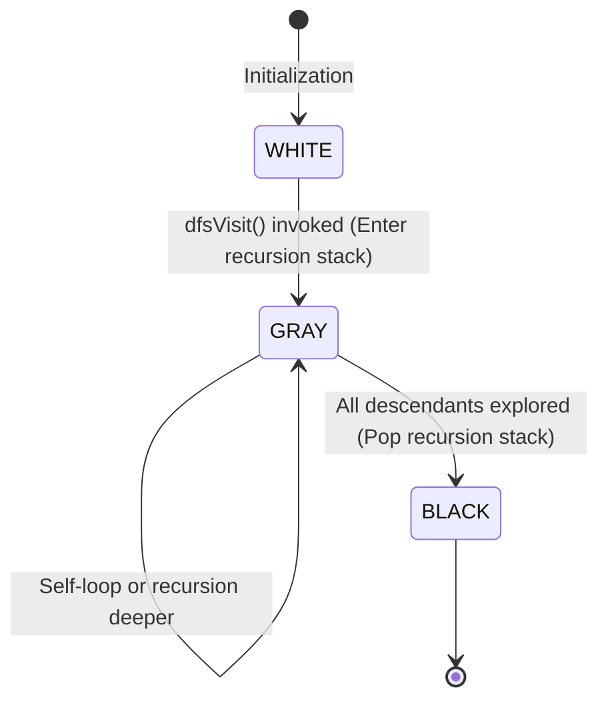

# Data Structures and Algorithms Reference — FraudGraph

This document provides a formal, textbook-grade academic reference for the data structures and graph algorithms implemented in **FraudGraph**. It is designed for faculty evaluation, viva preparation, and deep technical comprehension.

---

## 1. Graph Representation: Directed Adjacency List

### 1.1 Mathematical Definition
A financial transaction network is modeled as a finite directed graph:
$$G = (V, E)$$
where:
- $V$ is the set of accounts (vertices), where each vertex $v \in V$ possesses account attributes (ID, name, risk tier).
- $E$ is the set of directed transactions (edges), where each directed edge $e = (u, v) \in E$ indicates an irreversible transfer of funds from sender account $u$ to receiver account $v$.
- Each edge $e$ carries an integer monetary weight $w(e) \in \mathbb{Z}^+$ denominated in **paise** ($1\text{ INR} = 100\text{ paise}$).

### 1.2 Data Structure Selection: Adjacency List vs. Adjacency Matrix

| Property | Adjacency Matrix | Directed Adjacency List (FraudGraph Implementation) |
| :--- | :---: | :---: |
| **Memory Consumption** | $\Theta(\|V\|^2)$ | $\Theta(\|V\| + \|E\|)$ |
| **Iterate Outgoing Edges** | $\Theta(\|V\|)$ | $\Theta(\text{deg}^+(u))$ |
| **Edge Lookup $(u, v)$** | $\Theta(1)$ | $O(\text{deg}^+(u))$ |
| **Suitability for Financial Networks** | Poor (Prohibitive space on sparse networks) | **Optimal** (Financial networks are sparse: $\|E\| \ll \|V\|^2$) |

In financial graphs, the average account interacts with a small fraction of all existing accounts ($|E| \ll |V|^2$). Storing an adjacency matrix for 100,000 accounts would require $\approx 10^{10}$ entries (tens of gigabytes of wasted zeros). An adjacency list stores only actual transactions, achieving optimal linear space $\Theta(|V| + |E|)$.

### 1.3 Implementation in C++17
Implemented in [`engine/src/graph.hpp`](file:///Users/jeedijoshua/Documents/2nd%20Year/ODD%20SEM/DSA/MP/engine/src/graph.hpp) and [`engine/src/graph.cpp`](file:///Users/jeedijoshua/Documents/2nd%20Year/ODD%20SEM/DSA/MP/engine/src/graph.cpp):

```cpp
namespace fraudgraph {

class DirectedGraph {
private:
    // Vertex registry: account_id -> Account metadata
    std::unordered_map<std::string, Account> accounts_;

    // Outgoing adjacency list: from_account -> vector of outgoing transactions (u -> v)
    std::unordered_map<std::string, std::vector<Transaction>> adj_;

    // Incoming reverse adjacency list: to_account -> vector of incoming transactions (v <- u)
    std::unordered_map<std::string, std::vector<Transaction>> rev_adj_;

    // Fast transaction index by unique ID
    std::unordered_map<std::string, Transaction> transactions_by_id_;
};

}
```

#### Dual Adjacency Lists (Forward & Reverse)
Standard adjacency lists only store outgoing edges $u \to v$, making incoming degree and upstream traversal computationally expensive ($O(|V| + |E|)$ scan). FraudGraph maintains **both** forward (`adj_`) and reverse (`rev_adj_`) lists. This permits calculating:
- Out-Degree $\text{deg}^+(u) = |\text{adj}[u]|$ in $O(1)$ time.
- In-Degree $\text{deg}^-(u) = |\text{rev\_adj}[u]|$ in $O(1)$ time.
- Total incoming and outgoing volumes in $O(\text{deg}(u))$ time.

#### Hash Table Complexity Qualification
`std::unordered_map` provides average-case $O(1)$ key lookups. In the worst-case scenario with extreme hash collisions, lookup degrades to $O(|V|)$. To prevent non-deterministic traversal orders caused by hash bucket layout differences across compilers, edge iterators deterministically sort destination IDs before exploration.

---

## 2. Breadth-First Search (BFS) & Shortest Path Discovery

### 2.1 Problem Formulation
Given a directed graph $G = (V, E)$ and a source vertex $s \in V$, explore all reachable vertices in increasing order of their distance from $s$. Distance $\delta(s, v)$ is defined as the **minimum number of directed edges (hops)** on any path from $s$ to $v$.

### 2.2 Algorithm & Queue Mechanics
BFS explores the graph in concentric wavefronts using a First-In, First-Out (**FIFO**) queue:
1. Initialize a distance map `dist[v] = infinity` for all $v \in V$, and a boolean `visited` map.
2. Mark source $s$: `visited[s] = true`, `dist[s] = 0`. Enqueue $s$ into queue $Q$.
3. While $Q$ is not empty:
   - Dequeue front vertex $u$. Record a traversal step.
   - For each outgoing directed edge $(u, v) \in \text{adj}[u]$:
     - If $v$ has not been visited:
       - `visited[v] = true`
       - `dist[v] = dist[u] + 1`
       - Record predecessor: `pred[v] = (u, tx)`
       - Enqueue $v$ into $Q$.

### 2.3 Shortest-Path Reconstruction via Backtracking
Implemented in [`engine/src/algorithms.cpp:277-375`](file:///Users/jeedijoshua/Documents/2nd%20Year/ODD%20SEM/DSA/MP/engine/src/algorithms.cpp#L277-L375):
When the target vertex $t$ is reached (or when BFS terminates), the shortest path is reconstructed by following predecessor pointers backwards from $t$ to $s$:
```
t  <-- pred[t]  <-- pred[pred[t]]  <-- ... <-- s
```
Reversing this sequence yields the ordered shortest transmission path.

### 2.4 Mathematical Invariant & Complexity
- **Hop-Count Optimality:** BFS is mathematically proven to find the minimum-hop path in an unweighted directed graph because vertices are enqueued and dequeued in non-decreasing order of their distance from the source.
- **Important Qualification:** BFS finds the path with the **minimum number of hops (edges)**. It does **not** minimize cumulative transaction amounts or financial risk.
- **Time Complexity:** $O(|V| + |E|)$. Every reachable vertex is enqueued at most once ($O(|V|)$), and its outgoing adjacency list is scanned at most once ($O(|E|)$).
- **Auxiliary Space:** $O(|V|)$ for the queue, visited map, and predecessor table.

---

## 3. Depth-First Search (DFS) & Parenthesis Theorem

### 3.1 Problem Formulation
Given a directed graph $G = (V, E)$, explore as deeply as possible along each branch before backtracking.

### 3.2 Recursive Mechanics & Timestamps
Implemented in [`engine/src/algorithms.cpp:94-164`](file:///Users/jeedijoshua/Documents/2nd%20Year/ODD%20SEM/DSA/MP/engine/src/algorithms.cpp#L94-L164):
A global clock counter is incremented on every significant event:
- **Discovery time $d[u]$:** Timestamp when vertex $u$ is first discovered and entered on the call stack.
- **Finish time $f[u]$:** Timestamp after all outgoing edges from $u$ have been recursively traversed.

### 3.3 The Parenthesis Theorem
For any two vertices $u$ and $v$ in a DFS forest, exactly one of the following three conditions holds:
1. Intervals $[d[u], f[u]]$ and $[d[v], f[v]]$ are entirely disjoint $\implies$ neither vertex is an ancestor of the other in the DFS tree.
2. Interval $[d[u], f[u]]$ is strictly contained within $[d[v], f[v]]$ $\implies u$ is a proper descendant of $v$ in the DFS tree.
3. Interval $[d[v], f[v]]$ is strictly contained within $[d[u], f[u]]$ $\implies v$ is a proper descendant of $u$ in the DFS tree.

### 3.4 Complexity
- **Time Complexity:** $O(|V| + |E|)$.
- **Auxiliary Space:** $O(|V|)$ for the recursion call stack and timestamp maps.

---

## 4. Directed Cycle Detection via Three-State DFS

### 4.1 Why Standard Boolean Visited Arrays Fail in Directed Graphs
In an **undirected** graph, encountering an already-visited vertex immediately signals a cycle.  
In a **directed** graph, this rule is **false**. Consider a diamond DAG:
```
    S
   / \
  v   v
  A   B
   \ /
    v
    T
```
If DFS explores $S \to A \to T$, vertex $T$ is marked visited. When DFS backtracks and explores $S \to B \to T$, it reaches an already-visited vertex $T$ via a **cross-edge**. However, this graph is an acyclic DAG with zero cycles. A simple boolean visited check produces false positives.

### 4.2 Three-State Node Coloring Algorithm
Implemented in [`engine/src/algorithms.cpp:168-274`](file:///Users/jeedijoshua/Documents/2nd%20Year/ODD%20SEM/DSA/MP/engine/src/algorithms.cpp#L168-L274):
To distinguish back-edges from cross-edges and forward-edges, every vertex is assigned one of three colors:

```
+---------------+-------------------------------------------------------------------+
| Color / State | Semantic Meaning in Recursion Stack                               |
+---------------+-------------------------------------------------------------------+
| WHITE (0)     | Unvisited. Vertex has not yet been discovered.                    |
| GRAY (1)      | Active. Vertex is currently on the recursion call stack.          |
| BLACK (2)     | Finished. Vertex and all descendant subtrees are fully explored. |
+---------------+-------------------------------------------------------------------+
```



### 4.3 Back-Edge Cycle Theorem
> **Theorem:** A directed graph $G$ contains a directed cycle if and only if a depth-first search of $G$ yields at least one **back-edge**—an edge $(u, v)$ where the destination vertex $v$ is currently **GRAY**.

When a back-edge $(u, v)$ is traversed:
1. Since $v$ is `GRAY`, $v$ is an active ancestor of $u$ on the call stack.
2. A directed path $v \leadsto u$ currently exists on the stack.
3. The directed edge $u \to v$ closes the loop, forming a directed cycle:
   $$v \to \dots \to u \to v$$

### 4.4 Reconstructing the Cycle Path
FraudGraph maintains an active path stack `path_stack` and transaction edge stack `edge_stack`. When $(u, v)$ points to a `GRAY` node:
- If $u = v$: Identifies a **self-loop** (`cycle.is_self_loop = true`).
- If $u \neq v$: Locates the index of $v$ in `path_stack` and slices the sequence from $v$ to $u$, appending $v$ at the end to close the cycle loop. The corresponding transaction IDs are simultaneously collected.

---

## 5. Integer Monetary Representation (Paise)

### 5.1 The IEEE-754 Precision Hazard
Standard floating-point types (`float` and `double`) use binary representation:
$$\text{value} = (-1)^s \times (1 + m) \times 2^{e - 1023}$$
Because $0.1$ has an infinite repeating binary expansion ($0.0001100110011\dots_2$), cumulative financial operations introduce rounding errors:
```cpp
// Floating-point hazard:
double a = 0.10;
double b = 0.20;
// a + b == 0.30000000000000004 != 0.30
```
In automated accounting audits, this causes artificial flow discrepancies.

### 5.2 The Integer Invariant
FraudGraph stores all currency amounts internally as 64-bit signed integers:
```cpp
using AmountPaise = int64_t; // 1 INR = 100 paise
```
All sums, inflows, outflows, and difference equations are computed via exact integer arithmetic:
$$\text{discrepancy\_paise} = \text{total\_incoming\_paise} - \text{total\_outgoing\_paise}$$
Only during final JSON serialization for the UI is the value divided by 100.0 for human-readable display.

---

## 6. Worked Example: Forensic Investigation Pipeline

Consider the following 3-account transmission chain:
```
  [ ACC_ALICE ]  ----( TX_CHAIN_01: ₹50,000 )---->  [ ACC_MULE_X ]  ----( TX_CHAIN_02: ₹42,000 )---->  [ ACC_TARGET_D ]
```

### 6.1 Step 1: Adjacency List Construction
```cpp
adj_["ACC_ALICE"]    = { TX_CHAIN_01 (to: "ACC_MULE_X", amount: 5000000 paise) };
adj_["ACC_MULE_X"]   = { TX_CHAIN_02 (to: "ACC_TARGET_D", amount: 4200000 paise) };
adj_["ACC_TARGET_D"] = { };

rev_adj_["ACC_ALICE"]    = { };
rev_adj_["ACC_MULE_X"]   = { TX_CHAIN_01 (from: "ACC_ALICE", amount: 5000000 paise) };
rev_adj_["ACC_TARGET_D"] = { TX_CHAIN_02 (from: "ACC_MULE_X", amount: 4200000 paise) };
```

### 6.2 Step 2: BFS Shortest Path (`ACC_ALICE` to `ACC_TARGET_D`)
- Queue: `["ACC_ALICE"]` $\implies$ pop `ACC_ALICE`, visit `ACC_MULE_X` (dist = 1, pred = `ACC_ALICE`).
- Queue: `["ACC_MULE_X"]` $\implies$ pop `ACC_MULE_X`, visit `ACC_TARGET_D` (dist = 2, pred = `ACC_MULE_X`).
- Reconstructed shortest path: `["ACC_ALICE", "ACC_MULE_X", "ACC_TARGET_D"]` (Hop count: 2).

### 6.3 Step 3: Heuristic Rule Evaluation
- **Intermediary Node Evaluation:**  
  `ACC_MULE_X` has $\text{in\_deg} = 1 \ge 1$ and $\text{out\_deg} = 1 \ge 1$.
  - $\text{Total Inflow} = 5,000,000\text{ paise (₹50,000)}$.
  - $\text{Total Outflow} = 4,200,000\text{ paise (₹42,000)}$.
  - $\text{Net Discrepancy} = 5,000,000 - 4,200,000 = 800,000\text{ paise (₹8,000)}$.
  - $\text{Discrepancy Percentage} = \frac{800,000}{5,000,000} \times 100\% = 16.0\%$.
  - **Verdict:** Flagged under `RULE_INTERMEDIARY_MULE` with high-severity warning and neutral non-fraud explanation.
